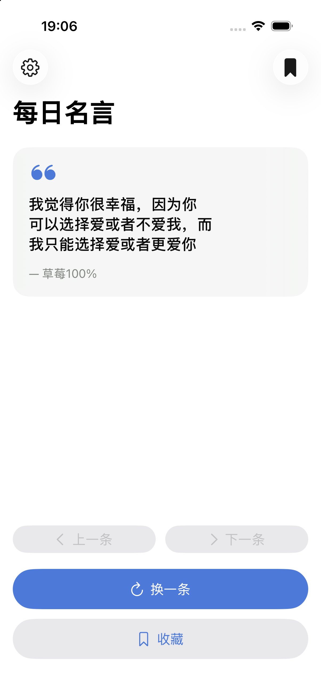
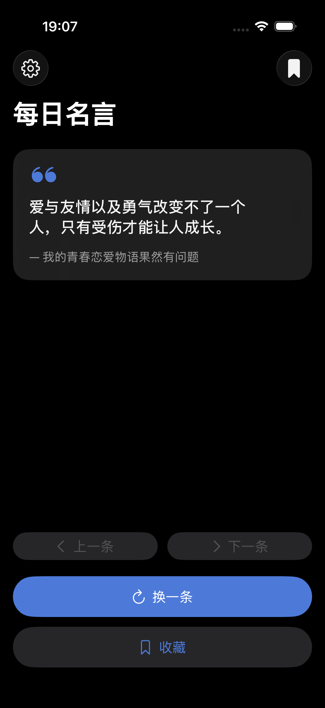
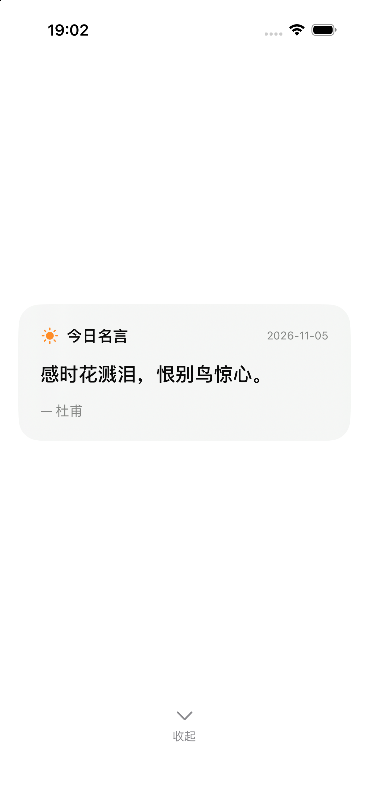

# Цитаты дня / 每日名言 / Daily Quotes

Мобильное приложение для iOS на **Swift + SwiftUI**: случайная цитата дня.
Учебный проект — демонстрирует архитектуру, работу с сетью, базу данных и тесты.

## Возможности

- **Цитата дня**: при запуске открывается цитата текущего дня; любое действие
  сворачивает её в полосу сверху, откуда можно снова вытянуть. Включается и
  выключается в настройках, обновляется раз в сутки
- Случайная цитата по кнопке «Другая цитата»
- **Случайный язык**: режим, при котором каждая цитата берётся из случайного
  набора (китайского, английского или русского)
- Сохранение в избранное (SwiftData, переживает перезапуск)
- **Три языка интерфейса**: 中文 / English / Русский — переключаются в настройках без перезапуска
- **Три языка цитат**, независимо от языка интерфейса
- **Очистка избранного** одним нажатием (с подтверждением)
- **Сброс приложения** к состоянию «только что установлено»

## Стек

| Слой | Технология |
|---|---|
| Язык | Swift 5 |
| UI | SwiftUI (Button, Label, List, Picker, NavigationStack, Form) |
| Архитектура | MVVM + Repository + внедрение зависимостей |
| Сеть | `URLSession` + `async/await`, протокол `RemoteQuoteSource` |
| База данных | SwiftData (`@Model`, `@Query`, `ModelContext`) |
| Настройки | `UserDefaults` поверх `@Observable` |
| Тесты | XCTest — **69 тестов** |
| Сборка | XcodeGen (`project.yml`) |

## Банк из 300 цитат + обновление по API

На каждый язык создаётся **локальный банк на 300 цитат**, который хранится на
устройстве (`Application Support/DailyQuotes/bank-<lang>.json`). Банк наполняется
из сети и затем служит быстрым источником показа.

| Язык | Стартовый набор | Быстрое обновление (bulk) |
|---|---|---|
| 中文 | `zh_quotes.json` — 38 | официальный пакет hitokoto (≈10 000 цитат, одним запросом) |
| English | `en_quotes.json` — 40 | dummyjson, страницы по 100 |
| Русский | `russian_quotes.json` — 63 | Викицитатник, 10 страниц параллельно + резервный JSON |
| Случайный | все три набора | смешивает источники, язык выбирается на каждую цитату |

**Как работает цикл показа:**

- Каждый показ помечает цитату как показанную.
- **Каждые 30 показов** показанные цитаты удаляются из банка, а на их место
  подгружаются новые из сети.
- Банк никогда не зацикливается на одном и том же: показанное не возвращается,
  пока не начнётся новый цикл (когда банк почти опустел).
- **История хранит 20 последних цитат** — можно вернуться назад и вперёд.
- **Избранное хранится в SwiftData и никак не связано с банком**: удаление или
  обновление банка не затрагивает сохранённые цитаты.

### Фильтрация по языку

Публичные паки не всегда моноязычные: в наборе hitokoto встречаются английские
цитаты, а на страницах Викицитатника — иноязычные фрагменты. Поэтому каждая
цитата проходит проверку письменности перед добавлением в банк
(`LanguageFilter`):

- китайский банк — требует доминирования CJK-иероглифов;
- русский банк — доминирования кириллицы;
- английский банк — доминирования латиницы без CJK и кириллицы.

Проверка выполняется дважды: при загрузке из сети и при записи в банк, так что
ни один источник не может занести чужой язык.

**Скорость**: холодное наполнение банка до 300 цитат занимает ≈3–6 секунд
(раньше занимало минуты из-за последовательных запросов). Первая цитата
показывается сразу из встроенного набора, наполнение идёт в фоне.

## Архитектура

```
DailyQuotes/
├── App/
│   └── DailyQuotesApp.swift        # точка входа + composition root (DI)
├── Models/
│   ├── Quote.swift                 # доменная модель
│   ├── Language.swift              # AppLanguage / QuoteLanguage
│   ├── LanguageFilter.swift        # проверка письменности цитаты
│   ├── AppTheme.swift              # системная / светлая / тёмная тема
│   ├── DailyQuote.swift            # модель «цитата дня» + ключ суток
│   └── L10n.swift                  # строки интерфейса на трёх языках
├── Networking/
│   ├── QuoteDTO.swift              # DTO: dummyjson, hitokoto, файлы банков
│   ├── QuoteAPIError.swift         # ошибка, доходящая до UI
│   ├── BulkQuoteSource.swift       # пакетная загрузка (hitokoto, dummyjson)
│   └── RussianQuoteFetcher.swift   # Викицитатник + резервный JSON
├── Persistence/
│   ├── SavedQuote.swift            # SwiftData @Model + репозиторий избранного
│   ├── QuoteBankStorage.swift      # JSON-файлы банков на диске
│   └── DailyQuoteStore.swift       # хранение цитаты дня
├── Settings/
│   ├── AppSettings.swift           # настройки, тема, сброс
│   └── SettingsView.swift          # экран настроек
├── Features/
│   ├── QuoteList/                  # банк, история, цитата дня, ViewModel и экран
│   └── Favorites/                  # избранное + очистка
├── Components/
│   └── QuoteCard.swift
└── Resources/
    ├── Assets.xcassets
    ├── zh_quotes.json              # стартовый набор: 37
    ├── en_quotes.json              # стартовый набор: 40
    └── russian_quotes.json         # стартовый набор: 63
```

**Разделение ответственности:** `QuoteListViewModel` не знает ни про
`URLSession`, ни про `SwiftData` — только протоколы `RemoteQuoteSource` и
`QuoteStoring`. Поэтому он тестируется без сети и без базы.

## Работа с сетью

Сетевые сбои обрабатываются внутри и **не доходят до пользователя**: банк
всегда отдаёт цитату из локального набора. До UI доходит единственная ошибка —
`libraryMissing` («нет доступных цитат»), и только когда локальный банк пуст.

Китайские и английские цитаты загружаются реальными HTTP-запросами через
`URLSession`; русские — из Викицитатника с резервным JSON-набором.

## База данных

```swift
@Model
final class SavedQuote {
    @Attribute(.unique) var quoteID: Int
    var text: String
    var author: String
    var savedAt: Date
}
```

Экран «Избранное» читает данные через `@Query`, поддерживает удаление свайпом
и полную очистку (`context.delete(model: SavedQuote.self)`).

## Настройки

| Настройка | Хранение | Поведение |
|---|---|---|
| Язык интерфейса | `UserDefaults` | мгновенно, без перезапуска |
| Язык цитат | `UserDefaults` | перезапрашивает цитату на новом языке |
| Очистка избранного | SwiftData | с подтверждением |
| Сброс приложения | оба | удаляет избранное + возвращает настройки по умолчанию |
| Тема оформления | `UserDefaults` | системная / светлая / тёмная |
| Цитата дня | `UserDefaults` | вкл/выкл; сама цитата хранится отдельно до смены суток |

**Оформление**: три варианта темы (`system`, `light`, `dark`) переключаются в
настройках без перезапуска. «Системная» следует настройке iOS.

**Очистка избранного** находится на экране «Избранное» (кнопка в левом верхнем
углу, с подтверждением) — рядом с самими данными, а не в настройках.

При первом запуске язык выбирается по системной локали.

## Тесты

```bash
xcodebuild test -project DailyQuotes.xcodeproj -scheme DailyQuotes \
  -destination 'platform=iOS Simulator,name=iPhone 17 Pro' \
  CODE_SIGNING_ALLOWED=NO
```

**69 тестов, все проходят** (10 классов):

| Класс | Тестов | Что проверяет |
|---|---|---|
| `QuoteListViewModelTests` | 9 | загрузка, смена языка, избранное, история, мгновенное обновление |
| `LanguageFilterTests` | 10 | отсев чужого языка в каждом из трёх банков |
| `QuoteBankTests` | 9 | переработка каждые 30 показов, отсутствие повторов, ёмкость 300 |
| `QuoteHistoryTests` | 7 | навигация «предыдущая/следующая», окно в 20 записей |
| `QuoteDecodingTests` | 6 | dummyjson, hitokoto, файлы банков, неверная схема |
| `RussianQuoteParsingTests` | 4 | разбор страниц Викицитатника, стабильные id |
| `QuoteBankStorageTests` | 2 | сохранение и чтение банка с диска |
| `DailyQuoteTests` | 4 | ключ суток, смена дня, Codable |
| `DailyQuoteStoreTests` | 3 | сохранение, чтение и очистка цитаты дня |
| `RandomLanguageTests` | 5 | разворачивание «случайного» языка, фильтр письменности |
| `DailyQuoteViewModelTests` | 10 | выдача раз в сутки, свёртывание/разворачивание |

Сеть в тестах **не используется**: источники подменяются `MockRemoteSource`,
база — `MockQuoteStore`, хранилище банка — `MockBankStorage`.

## Сборка

```bash
xcodegen generate
open DailyQuotes.xcodeproj
```

Или из командной строки:

```bash
xcodebuild -project DailyQuotes.xcodeproj -scheme DailyQuotes \
  -sdk iphonesimulator -destination 'platform=iOS Simulator,name=iPhone 17 Pro' \
  CODE_SIGNING_ALLOWED=NO build
```

## Скриншоты

| Светлая тема | Тёмная тема |
|---|---|
|  |  |

| Цитата дня при запуске |
|---|
|  |

## Требования

- Xcode 15+ (проверено на Xcode 27 / iOS 26.5)
- iOS 17.0+
